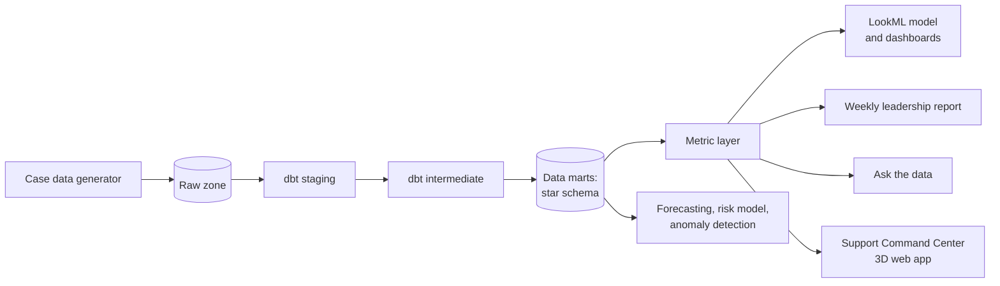

# cloud-support-bi

[](https://github.com/mohammadazam7/cloud-support-bi/actions/workflows/ci.yml)

Single-source-of-truth analytics for a cloud support organization: raw case events
modelled into tested data marts, one governed definition per metric, dashboards on top of
that layer, and leadership reporting that builds itself.

> **Status:** in development. The data generator, the dbt star schema and the governed
> metric layer are built and tested; LookML, access controls and the weekly report are
> next. See the [roadmap](docs/ROADMAP.md) for milestone dates.

## Results so far

Measured on the default synthetic year (seed 7: 1,200 customers, 80 agents, 89,708
cases). The data is synthetic, so these numbers show the pipeline works end to end, not
facts about any real support organization.

| Measure | Value |
|---|---|
| dbt models, seeds and tests passing | 77 |
| First-response SLA attainment | 78.2% |
| Mean CSAT when the SLA was met / missed | 4.27 / 3.20 |
| Mean open backlog, P1 to P4 | 4.7 / 45 / 247 / 299 cases |
| Python test coverage | 98% |

Reproduce with `make data models` and
`support-bi metric first_response_sla_attainment --warehouse data/warehouse.duckdb`.

## Overview

Support organizations usually have the data to answer their operating questions (are
we meeting SLAs, where is the backlog growing, which cases are about to escalate) but
not one agreed answer. Each team computes time to resolution slightly differently, and
leadership reviews spend their first ten minutes reconciling numbers.

This project builds the layer that removes that argument. Case and event data lands in
a raw zone, is cleaned and conformed by dbt into a star schema, and every metric is
defined once in a governed metric layer that dashboards, reports and ad hoc questions
all read from. Data quality is tested on every build, and access to customer-identifying
fields is controlled at the model and dashboard layers.

The case data is a seeded synthetic data set with the shape of a real cloud support
operation (products, priorities, SLAs, escalations, satisfaction surveys, agents and
queues). It is labelled synthetic wherever it appears, since real support data is not
public.

## Architecture



| Layer | Responsibility |
|---|---|
| Generator | Reproducible case, event, survey and staffing data with realistic seasonality, priority mix and SLA behaviour |
| dbt staging and intermediate | Type casting, UTC conversion, case lifecycle reconstruction from events, customer tier periods |
| Data marts | `fct_cases`, `fct_case_events`, `dim_customer` (type 2 history of support tier), `dim_product`, `dim_agent`, `dim_date` |
| Metric layer | One definition per metric: first response time, time to resolution, SLA attainment, backlog, CSAT, escalation rate, reopen rate |
| BI | LookML views, explores and dashboards with row-level access filters |
| Automation | Scheduled build of the weekly leadership report |
| Analytics | Case volume forecast, escalation risk model, SLA breach anomaly detection, process change impact analysis |

See [docs/architecture.md](docs/architecture.md) for the star schema, quality gates and
[design decisions](docs/adr/README.md).

SQL is written in the BigQuery dialect. Continuous integration runs the same dbt models
on DuckDB, so every change is built and tested without cloud credentials; the BigQuery
target deploys them unchanged.

## Getting started

```bash
python -m venv .venv && source .venv/bin/activate
make install
make check
support-bi generate --out data/raw      # one synthetic year, about 90k cases
support-bi verify --out data/raw        # files match the manifest
```

The default run (seed 7, 365 days, 1,200 customers, 80 agents) writes 89,708 cases,
376,181 lifecycle events and 30,490 survey responses in under 3 seconds on a laptop CPU.
Every table is synthetic and the manifest says so.

## License

MIT
