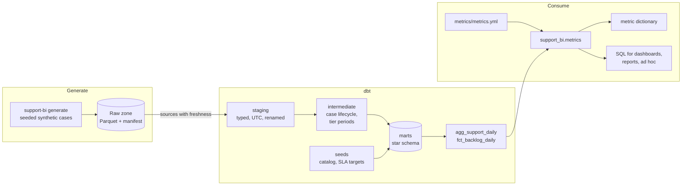
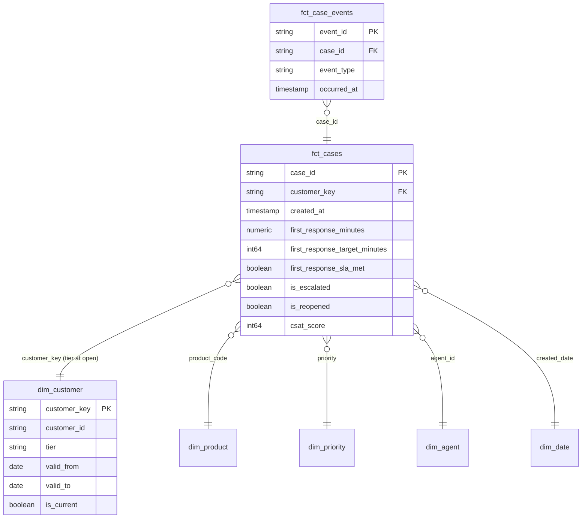
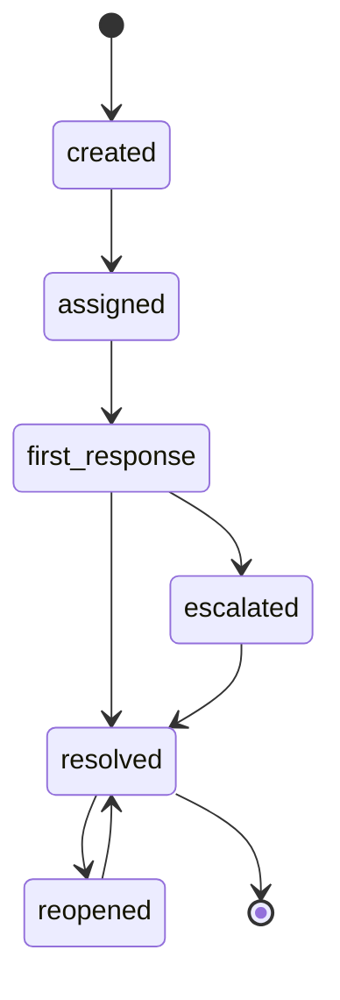

# Architecture

How support case data moves from the raw zone to the numbers leadership sees, and why
each layer exists. Decisions with real alternatives are recorded as
[architecture decision records](adr/README.md).

## Data flow

The generator and the warehouse share one catalog (`support_bi.catalog`): the SLA
targets the generator uses to decide whether a response was late are written by
`support-bi seeds` into the `sla_targets` seed the marts join to. A test fails if the
committed seeds drift from the catalog.

## Star schema

| Model | Grain | Materialization | On BigQuery |
|---|---|---|---|
| `fct_cases` | one case | table, contract enforced | partitioned by month of `created_date`, clustered by product and priority |
| `fct_case_events` | one lifecycle event | incremental, unique key `event_id`, 3-day lookback | partitioned by day, clustered by event type |
| `dim_customer` | one customer per tier period | table | |
| `agg_support_daily` | day x product x priority x tier x channel | table | partitioned by month, clustered by product and priority |
| `fct_backlog_daily` | day x product x priority | table | |

## Case lifecycle

`int_case_lifecycle` pivots these events into one row per case. A reopened case has two
`resolved` events: the first sets `first_resolved_at` (used for time to resolve), the
last sets `final_resolved_at` (used for the backlog).

## Metric layer

Every metric is defined once in `metrics/metrics.yml` with its unit, direction and
owner. Ratio metrics are computed as a sum over a sum of the additive components in
`agg_support_daily`, so they are correct at any grain; medians are computed from
`fct_cases`; the backlog averages daily levels. See
[ADR 0003](adr/0003-additive-metric-components.md) and the
[metric dictionary](metric_dictionary.md).

## Quality gates

| Check | Where | Fails the build when |
|---|---|---|
| Source freshness | `_sources.yml` | no new cases, events or surveys for 4 days (warns at 2) |
| Generic tests | staging, marts, seeds | a key is null or duplicated, a relationship breaks, a code is unknown |
| Model contract | `fct_cases` | a column is renamed, dropped or changes type |
| Reconciliation | `tests/singular` | a case is missing from `fct_cases`, tier periods overlap, milestones are out of order, the daily aggregate does not add back to the fact, the backlog goes negative |
| Python | `tests/` | the generator, raw zone, seeds or metric layer break, or coverage drops below 85% |

## Targets

The same models run on two dbt targets. `duckdb` (the default) reads the raw zone's
Parquet files directly and is what CI builds on every pull request. `bigquery` reads the
`raw` dataset and applies the partitioning and clustering configs; it needs a GCP
project and credentials in the environment and has not been run from CI.
